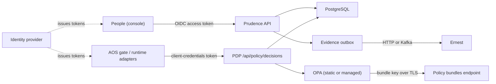

# Prudence Threat Model

Prudence decides whether an AI system may run and keeps the record of who approved what. This
document states what it guarantees, what each guarantee rests on, what it does not guarantee, and
what an operator must do. Prudence is a governance-readiness platform, not a legal declaration of
EU AI Act conformity.

## What Prudence is

The governance control plane of Chestertown. People declare AI systems in a **registry** (with a
classification dossier), submit them for **review**, and approve, reject, renew or suspend them.
Workloads (an AOS gate, a runtime adapter) ask its **policy decision point** whether a pipeline
may run. The PDP first applies the registry (unknown, prohibited, unapproved or lapsed systems
never run), then the active policy in **OPA**. Every decision and review goes through a durable
outbox to **Ernest**, which makes the record tamper-evident. Who may do what comes from the
organization's **governance model** (contract `chestertown.governance/v1`).

## Assets

- The registry: systems, dossiers, approval state, approvers, accountabilities (PostgreSQL).
- Decisions and reviews, and the evidence outbox that delivers them to Ernest.
- Policies: drafts, approved revisions, publications, and the bundle key OPA fetches with
  (`PRUDENCE_MANAGED_BUNDLE_KEY`).
- The governance model file (`PRUDENCE_GOVERNANCE_MODEL`): it decides every function.
- Identity configuration: issuer, audience (`SPRING_SECURITY_OAUTH2_RESOURCESERVER_JWT_*`).
- Secrets: database credentials, Ernest key, Kafka credentials, SMTP.

## Trust boundaries

Prudence trusts the identity provider's signature and the governance model; it trusts nothing a
caller sends about who it is.

## Guarantees, and what each rests on

**G1 — Fail closed.** The PDP answers `ALLOW` only for a registered, approved, unexpired system
whose pipeline the active policy allows. An unknown system, a prohibited one, an unapproved or
lapsed one is denied (a pending high-risk system gets `APPROVAL_REQUIRED`); an unreachable OPA or
an inactive publication is `ERROR`. Rests on: AOS and the adapters treating anything but `ALLOW`
as "do not run" (AOS does, and also fails closed when Prudence is unreachable).

**G2 — Only workloads decide, only people review.** Each route needs a governance function.
`runtime.decide` and `runtime.report` are machine functions a person's token never resolves to;
`system.approve`, `policy.approve` and the rest are person functions. Tokens are checked for
issuer, audience and signature. Rests on: the identity provider and the governance model.

**G3 — Separation of duties.** A high-risk system needs two distinct approvers (the legal floor:
a model below it refuses to start). A system's owner never reviews it, and a policy draft's
contributors never approve it, whatever the model says. The model can add rules: approvals per
risk tier, required accountabilities before review, and incompatible functions such as
`[system.declare, system.approve]` (whoever registered or submitted a system cannot review it).
Rests on: stable identities (`PRUDENCE_IDENTITY_PRINCIPAL_MODE=issuer-subject` for production).

**G4 — Durable, reproducible evidence.** Decisions and reviews are written to a transactional
outbox in the same transaction as the state they record, and retried until Ernest has them. Each
decision carries the policy version and digest and the system version and model hash it was made
against. Rests on: Ernest being configured and reachable eventually; Prudence reports when it is
not.

**G5 — Only approved policy reaches OPA.** A policy is drafted, validated, approved by someone
else and published; OPA fetches the bundle over TLS with the bundle key, and a publication counts
as active only once OPA is observed serving that exact digest. Rests on: the bundle key staying
secret.

## What Prudence does NOT guarantee

**N1 — The identity provider and the governance model are trusted.** Whoever can assign roles in
the identity provider, or edit the model file, decides who may approve and who may run. Prudence
cannot tell a legitimate role assignment from a malicious one.

**N2 — Prudence decides on what it is told.** The dossier (risk tier, Annex III, affected
population) is declared by people; Prudence records it and its justification but cannot verify
it. A system misclassified as limited risk gets limited-risk treatment.

**N3 — Its own database is not tamper-evident.** A database administrator can change an approval
directly. The change is detectable afterwards, because reviews and decisions are sealed in
Ernest, but Prudence itself would act on the altered state until someone compares.

**N4 — Availability is a safety trade-off.** Because the PDP fails closed, a Prudence or OPA
outage stops every governed pipeline. That is intended; it is also a denial-of-service target.

**N5 — Legacy records.** Systems registered before Prudence recorded declarers are not covered by
the `[system.declare, system.approve]` rule, and records predating the dossier are reassessed
rather than trusted.

## Attack scenarios, explicitly

| Scenario | Outcome |
| --- | --- |
| A person calls the PDP with their own token | 403: a person never holds `runtime.decide` |
| A workload token is replayed to approve a system | 403: approving is a person function |
| An author approves their own high-risk system | Refused if they own it or (with the model rule) declared or submitted it; a second distinct approver is always required |
| The same person signs both high-risk approvals | Refused: the second approver must differ |
| A policy author approves their own draft | Refused, whatever the model says |
| A caller claims another subject in a PDP request | In managed mode the subject must be the token's own identity, or the decision is `ERROR` |
| OPA is down or serving an unexpected bundle | `ERROR`: governed pipelines do not run |
| The bundle key leaks | An attacker can read policy bundles; it cannot change what Prudence publishes. Rotate the key |
| Someone edits the governance model to grant themselves `system.approve` | Takes effect at the next start (N1): protect the file like a privileged credential |
| A DBA flips an approval in PostgreSQL | Prudence acts on it (N3); the missing review in Ernest exposes it on comparison |
| Ernest is down | Decisions still made; evidence waits in the outbox and Prudence reports the backlog |

## Operator obligations

1. **Configure the identity provider for production**: issuer, audience, and
   `PRUDENCE_IDENTITY_PRINCIPAL_MODE=issuer-subject` once stored approvals are migrated. Production
   refuses to start without issuer, audience, database credentials, Ernest key and CORS origins.
2. **Protect the governance model** like a privileged credential: read-only mount, change
   control, `ct_model.py check --strict` before deploying a change.
3. **Validate the identity provider** with `scripts/idp-acceptance.sh`.
4. **Keep the bundle key, database and Kafka credentials in a secrets manager.**
5. **Run Ernest** and watch Prudence's evidence health; back up PostgreSQL.
6. **Smoke-test after each deploy**: the PDP must allow an approved system and deny a prohibited
   and an unregistered one (`chestertown-infra/scripts/smoke.sh` on the MVP host).

## Known gaps before enterprise production

| Threat | Current state | Recommended next control |
| --- | --- | --- |
| Approval tampering in the database | Detectable through Ernest after the fact | Periodic reconciliation of approvals against sealed reviews |
| Bundle authenticity | Bundle key over TLS, digest observed | Signed bundles (OPA bundle signatures) |
| More than two approvals per tier | Refused at start (Prudence records first and final sign-off) | N-of-M approvals |
| Decision log | Decisions live in Ernest, not in a Prudence view | A per-decision view or export |
| Supply chain | Release images signed with cosign, with SBOM and provenance | Verify signatures at deploy time |

## Out of scope

Correctness of the policies an organization writes, legal advice or conformity assessment,
compromise of the identity provider or of OPA itself, and side channels.
